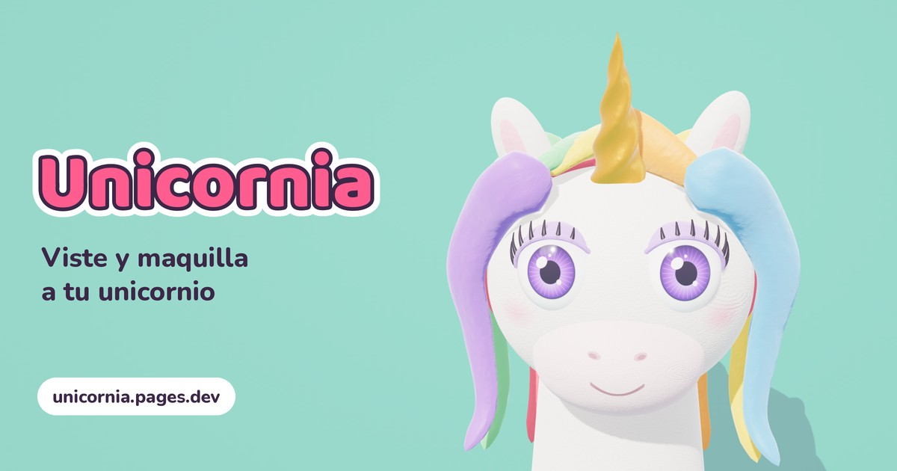
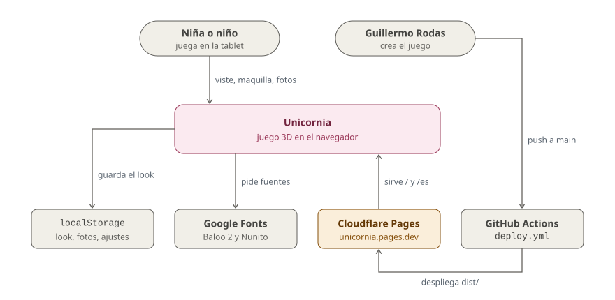

# Unicornia

**Viste, peina y maquilla a un unicornio de plastilina en 3D. Para niños que aún no leen; gratis y sin anuncios.**

[](https://github.com/glrodasz/unicornia/actions/workflows/deploy.yml)
[](LICENSE)
[](https://threejs.org)
[](https://unicornia.pages.dev)

<br clear="left">

[**Jugar**](https://unicornia.pages.dev) · [Cómo funciona](#cómo-funciona) · [Arquitectura](#arquitectura) · [Ejecutar en local](#ejecutar-en-local) · [Despliegue](#despliegue-en-cloudflare-pages)



## Por qué

Los juegos de vestir para niños pequeños suelen estar llenos de anuncios, compras dentro de la app y menús con texto que una niña de 4 años no puede leer. Unicornia es un salón de belleza para un solo unicornio, pensado para jugar sola en una tablet: todo se elige tocando iconos grandes, nada exige leer y no hay enlaces que saquen del juego.

Está hecho para niños en edad preescolar con una tablet o un teléfono. Funciona en cualquier navegador moderno con WebGL, sin instalar nada y sin cuentas.

| Principio | En la práctica |
|---|---|
| Se juega sin leer | Cada opción lleva icono; los botones son grandes; los menús envuelven a otra línea en vez de desplazarse de lado. |
| Pistas que se ven | Cuando un gesto no es obvio (girar el unicornio, rociar perfume, pegar stickers) aparece un dedito animado que lo muestra. |
| Nada saca del juego | Sin enlaces externos: el crédito copia la URL del autor al portapapeles con un aviso discreto. |
| Todo se queda en el aparato | El look, las fotos y los ajustes viven en `localStorage`; no hay servidor ni cuentas. |
| Corre en equipos modestos | Un modo ligero se activa solo en GPUs lentas (Raspberry Pi, Chromebooks viejos). |

## Ejecutar en local

Requisitos: Node.js 18 o superior. No hay `npm install`: el build no tiene dependencias.

```bash
git clone https://github.com/glrodasz/unicornia.git
cd unicornia
node scripts/build.mjs && npx serve dist   # como en producción: / (inglés) y /es
```

Abre la URL que imprime `serve`. Para ver solo el juego, en el idioma del navegador y sin build:

```bash
npx serve public
```

## Cómo funciona

Todo el juego es un solo archivo, [`public/index.html`](public/index.html): HTML, CSS y JavaScript sin framework, con [three.js](https://threejs.org) r149 servido desde `public/vendor/`. El unicornio se modela en código (tornos, elipsoides y curvas) y su aspecto de plastilina sale de una textura de ruido generada en un `<canvas>`.

El juego se organiza en pasos, en la barra superior de la bandeja:

| Paso | Qué se hace |
|---|---|
| **1 · Unicornio** | **Maquillaje** (pestañas, ojos y lentes de contacto, sombras, rubor, pecas, labios), **Accesorios** (aretes arriba y abajo, nariz, gafas, cabeza), **Colores** (pelaje, peinado y color del pelo, cuerno), **Stickers** y tatuajes, y **Perfume**. |
| **2 · Pezuñas** | Recortar pelitos, limar, pintar con esmaltes (colores, degradados y diseños) y decorar cada pezuña. |

Sobre el escenario:

- **Arrastrar** gira el unicornio en 3D.
- **Sorpresa** cambia todo al azar.
- **Cámara** toma una foto cuadrada de 640 px; el botón de **poses** ofrece Normal, ¡Patas arriba!, Hola, Guiño, Lengua y Tierna.
- **Mis fotos** guarda hasta 24 fotos. Desde el álbum se puede guardar una foto en la tablet (hoja de compartir del sistema o descarga) o volver a vestir al unicornio igual que en la foto.
- Los sonidos se sintetizan con Web Audio; el botón de sonido los silencia.

## Arquitectura

<picture>
  <source media="(prefers-color-scheme: dark)" srcset="docs/diagrams/context-dark.svg">
  
</picture>

Unicornia es un sitio estático: el juego corre entero en el navegador y no habla con ningún servidor propio. Cloudflare Pages (en ámbar) sirve los archivos; la única petición externa en tiempo de juego es a Google Fonts, y si falla se usan las fuentes del sistema.

`scripts/build.mjs` copia `public/` a `dist/` y genera dos páginas desde el mismo `index.html`: `/` en inglés y `/es` en español, cada una con su título, descripción, Open Graph y `hreflang` en el HTML, porque los crawlers de vistas previas no ejecutan JavaScript. Cada push a `main` despliega a producción y cada pull request recibe su propia URL de vista previa.

**Tech stack:** juego en HTML, CSS y JavaScript sin framework · 3D con three.js r149 · build en Node sin dependencias · alojamiento en Cloudflare Pages · CI/CD con GitHub Actions y Wrangler.

## Configuración

### URLs por idioma

- `/`: el juego en inglés (idioma por defecto), con título, descripción y etiquetas Open Graph en inglés. Si el primer idioma soportado del navegador es español, redirige al instante a `/es`.
- `/es`: el juego en español, con sus etiquetas en español. Nunca redirige: el idioma de la URL manda.
- `/en`, `/en/` y `/es/` redirigen (301) a `/` y `/es`.
- `public/index.html` sigue siendo la única fuente: `scripts/build.mjs` cambia solo las etiquetas del `<head>` y añade `hreflang`. Si renombras una de esas etiquetas, el build falla en vez de publicar etiquetas viejas.

### Parámetros de URL

| Parámetro | Efecto |
|---|---|
| `?lite=1` | Fuerza el modo ligero. |
| `?lite=0` | Desactiva el modo ligero. |
| `?fps=1` | Muestra FPS, modo y GPU en una esquina. |

El **modo ligero** quita antialias, sombras y brillos extra de los materiales (sheen y clearcoat), baja píxeles, polígonos y partículas, y limita a 30 fps. Se activa solo si el nombre de la GPU está en la lista lenta, o si los primeros segundos van a menos de ~22 fps; en ese caso se recuerda 7 días.

### Datos guardados

Todo vive en `localStorage` del navegador, con el prefijo `salon-unicornio-v1`:

| Clave | Contenido |
|---|---|
| `salon-unicornio-v1` | Apariencia del unicornio, pezuñas y stickers. |
| `salon-unicornio-v1-ui` | Paso, categoría y pestaña activas. |
| `salon-unicornio-v1-fotos` | Hasta 24 fotos (JPEG en data URL). |
| `salon-unicornio-v1-mute` | Sonido silenciado. |
| `salon-unicornio-v1-girado` | Ya giró el unicornio (oculta la pista de girar). |
| `salon-unicornio-v1-ligero` | Fecha en que se activó el modo ligero. |

### Despliegue en Cloudflare Pages

[`.github/workflows/deploy.yml`](.github/workflows/deploy.yml) ejecuta `node scripts/build.mjs` y publica `dist/` con Wrangler:

- Cada push a `main` se publica en producción: https://unicornia.pages.dev
- Cada pull request recibe su propia URL de vista previa, enlazada en un comentario del PR que se actualiza en cada push.

Necesita los secretos del repositorio `CLOUDFLARE_API_TOKEN` y `CLOUDFLARE_ACCOUNT_ID`; sin ellos el workflow construye pero no despliega. El proyecto de Pages se crea solo en el primer despliegue.

Para desplegar a mano:

```bash
node scripts/build.mjs && npx wrangler pages deploy dist --project-name unicornia
```

### Estructura del proyecto

```
public/                   fuente del sitio estático
  index.html              juego completo (HTML + CSS + JS en un solo archivo)
  og/                     imágenes para vistas previas al compartir (es y en)
  icons/, favicon.*       iconos de la app y manifiesto
  vendor/three.min.js     three.js r149, servido localmente
scripts/build.mjs         genera dist/: / (inglés) y /es
original/
  artifact-snapshot.html  copia exacta del artifact original de Claude, como referencia
docs/diagrams/            diagrama de contexto
.github/workflows/        despliegue a Cloudflare Pages
```

El juego nació como un artifact de Claude; `original/artifact-snapshot.html` guarda esa versión tal cual.

## Documentación

| Doc | Qué contiene |
|---|---|
| [`scripts/build.mjs`](scripts/build.mjs) | Cómo se generan `/` y `/es`, sus etiquetas SEO y Open Graph, y las redirecciones. |
| [`.github/workflows/deploy.yml`](.github/workflows/deploy.yml) | Build y despliegue a producción y a vistas previas de cada PR. |
| [`original/artifact-snapshot.html`](original/artifact-snapshot.html) | El artifact original del que partió el juego. |

## Contribuir

Casi todo el contenido del juego son listas al principio del `<script>` de `public/index.html`. Para añadir una opción:

1. Agrega la entrada a su lista: `STICKERS`, `HAIR`, `HORN`, `EYE`, `LENS`, `LASHES`, `GLASSES`, `HEADACC`, `POLISH`, `DECOS`, `POSES`… Cada una lleva un `id` estable y un `name` en español; los stickers y decoraciones se dibujan con capas de trazados SVG (`L`).
2. Añade la traducción al diccionario `EN` (`'Nombre en español':'English name'`), o se mostrará en español en `/`.
3. Comprueba que el build pasa y prueba en el navegador, en tablet y teléfono:

   ```bash
   node scripts/build.mjs && npx serve dist
   ```

Cada pull request despliega su propia vista previa en Cloudflare Pages; los PRs con cambios visuales llevan capturas de antes y después.

## Licencia

© 2026 Guillermo Rodas. Todos los derechos reservados. Ver [LICENSE](LICENSE).

[three.js](https://github.com/mrdoob/three.js) (incluido en `public/vendor/`) es © 2010-2023 Three.js Authors, bajo licencia MIT. Las fuentes Baloo 2 y Nunito se cargan desde Google Fonts bajo la SIL Open Font License.
