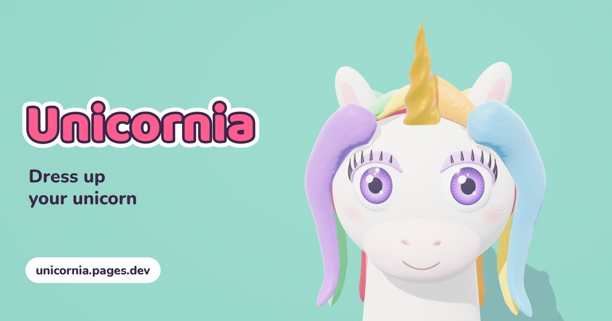

# Unicornia

**Dress up, style and do the makeup of a 3D clay unicorn. Made for kids who can't read yet; free and with no ads.**

[](https://github.com/glrodasz/unicornia/actions/workflows/deploy.yml)
[](LICENSE)
[](https://threejs.org)
[](https://unicornia.pages.dev)

<br clear="left">

[**Play**](https://unicornia.pages.dev) · [How it works](#how-it-works) · [Architecture](#architecture) · [Quick start](#quick-start) · [Deploy](#deploy-to-cloudflare-pages)



## Why

Dress-up games for young kids tend to be full of ads, in-app purchases and menus with text a 4-year-old can't read. Unicornia is a beauty salon for a single unicorn, built for a child to play alone on a tablet: everything is picked by tapping big icons, nothing requires reading, and no link ever leads out of the game.

It is made for preschoolers with a tablet or a phone. It runs in any modern browser with WebGL, with nothing to install and no accounts.

| Principle | In practice |
|---|---|
| Playable without reading | Every option has an icon; buttons are big; menus wrap to a new line instead of scrolling sideways. |
| Hints you can see | When a gesture isn't obvious (spinning the unicorn, spraying perfume, placing stickers), an animated finger shows how. |
| Nothing leads out | No external links: the credit copies the author's URL to the clipboard with a quiet notice. |
| Everything stays on the device | The look, the photos and the settings live in `localStorage`; there is no server and no account. |
| Runs on modest hardware | A light mode turns on by itself on slow GPUs (Raspberry Pi, old Chromebooks). |

## Quick start

Requires Node.js 18 or later. There is no `npm install`: the build has no dependencies.

```bash
git clone https://github.com/glrodasz/unicornia.git
cd unicornia
node scripts/build.mjs && npx serve dist   # like production: / (English) and /es
```

Open the URL `serve` prints. To run just the game, in the browser's language and with no build:

```bash
npx serve public
```

## How it works

The whole game is one file, [`public/index.html`](public/index.html): HTML, CSS and framework-free JavaScript, with [three.js](https://threejs.org) r149 served from `public/vendor/`. The unicorn is modeled in code (lathes, ellipsoids and curves), and its clay look comes from a noise texture generated in a `<canvas>`.

The game is organized in steps, shown in the bar at the top of the tray:

| Step | What you do |
|---|---|
| **1 · Unicorn** | **Makeup** (lashes, eyes and contact lenses, eyeshadow, blush, freckles, lips), **Accessories** (top and bottom earrings, nose, glasses, head), **Colors** (fur, hairstyle and hair color, horn), **Stickers** and tattoos, and **Perfume**. |
| **2 · Hooves** | Trim the tufts, file, paint with polishes (colors, gradients and patterns) and decorate each hoof. |

On the stage:

- **Drag** spins the unicorn in 3D.
- **Surprise** randomizes everything.
- **Camera** takes a 640 px square photo; the **poses** button offers Normal, Hooves up!, Hello, Wink, Silly tongue and Sweet.
- **My photos** keeps up to 24 photos. From the album a photo can be saved to the tablet (system share sheet or download), or the unicorn can be dressed exactly as in the photo.
- Sounds are synthesized with Web Audio; the sound button mutes them.

The game is in English at `/` and in Spanish at `/es`; the Spanish strings are the source and the `EN` dictionary in `index.html` translates them.

## Architecture

<picture>
  <source media="(prefers-color-scheme: dark)" srcset="docs/diagrams/context-dark.svg">
  
</picture>

Unicornia is a static site: the game runs entirely in the browser and talks to no server of its own. Cloudflare Pages (amber) serves the files; the only external request during play goes to Google Fonts, and system fonts take over if it fails.

`scripts/build.mjs` copies `public/` to `dist/` and generates two pages from the same `index.html`: `/` in English and `/es` in Spanish, each with its own title, description, Open Graph and `hreflang` tags in the HTML, because link-preview crawlers don't run JavaScript. Every push to `main` deploys to production and every pull request gets its own preview URL.

**Tech stack:** game in HTML, CSS and framework-free JavaScript · 3D with three.js r149 · dependency-free Node build · hosting on Cloudflare Pages · CI/CD with GitHub Actions and Wrangler.

## Configuration

### Language URLs

- `/`: the game in English (the default), with English title, description and Open Graph tags. If the browser's first supported language is Spanish, it redirects to `/es` right away.
- `/es`: the game in Spanish, with Spanish tags. It never redirects: the URL's language wins.
- `/en`, `/en/` and `/es/` redirect (301) to `/` and `/es`.
- `public/index.html` stays the single source: `scripts/build.mjs` only swaps the `<head>` tags and adds `hreflang`. If one of those tags is renamed, the build fails instead of shipping stale tags.

### URL parameters

| Parameter | Effect |
|---|---|
| `?lite=1` | Forces light mode. |
| `?lite=0` | Turns light mode off. |
| `?fps=1` | Shows FPS, mode and GPU in a corner. |

**Light mode** drops antialiasing, shadows and the extra material sheen (sheen and clearcoat), lowers pixels, polygons and particles, and caps the frame rate at 30 fps. It turns on by itself when the GPU name is on the slow list, or when the first seconds run below ~22 fps; in that case it is remembered for 7 days.

### Saved data

Everything lives in the browser's `localStorage`, under the `salon-unicornio-v1` prefix:

| Key | Contents |
|---|---|
| `salon-unicornio-v1` | The unicorn's look, hooves and stickers. |
| `salon-unicornio-v1-ui` | Active step, category and tab. |
| `salon-unicornio-v1-fotos` | Up to 24 photos (JPEG data URLs). |
| `salon-unicornio-v1-mute` | Sound muted. |
| `salon-unicornio-v1-girado` | The unicorn has been spun (hides the spin hint). |
| `salon-unicornio-v1-ligero` | When light mode was turned on. |

### Deploy to Cloudflare Pages

[`.github/workflows/deploy.yml`](.github/workflows/deploy.yml) runs `node scripts/build.mjs` and publishes `dist/` with Wrangler:

- Every push to `main` goes to production: https://unicornia.pages.dev
- Every pull request gets its own preview URL, linked from a PR comment that is updated on every push.

It needs the `CLOUDFLARE_API_TOKEN` and `CLOUDFLARE_ACCOUNT_ID` repository secrets; without them the workflow builds but doesn't deploy. The Pages project is created on the first deploy.

To deploy by hand:

```bash
node scripts/build.mjs && npx wrangler pages deploy dist --project-name unicornia
```

### Project layout

```
public/                   static site source
  index.html              the whole game (HTML + CSS + JS in one file)
  og/                     link-preview images (es and en)
  icons/, favicon.*       app icons and manifest
  vendor/three.min.js     three.js r149, served locally
scripts/build.mjs         builds dist/: / (English) and /es
original/
  artifact-snapshot.html  exact copy of the original Claude artifact, for reference
docs/diagrams/            context diagram
.github/workflows/        deploy to Cloudflare Pages
```

The game started as a Claude artifact; `original/artifact-snapshot.html` keeps that version as it was.

## Documentation

| Doc | What's in it |
|---|---|
| [`scripts/build.mjs`](scripts/build.mjs) | How `/` and `/es` are generated, their SEO and Open Graph tags, and the redirects. |
| [`.github/workflows/deploy.yml`](.github/workflows/deploy.yml) | Build and deploy to production and to per-PR previews. |
| [`original/artifact-snapshot.html`](original/artifact-snapshot.html) | The original artifact the game grew from. |

## Contributing

Almost all of the game's content is lists at the top of the `<script>` in `public/index.html`. To add an option:

1. Add the entry to its list: `STICKERS`, `HAIR`, `HORN`, `EYE`, `LENS`, `LASHES`, `GLASSES`, `HEADACC`, `POLISH`, `DECOS`, `POSES`… Each one has a stable `id` and a Spanish `name`; stickers and decorations are drawn from layers of SVG paths (`L`).
2. Add the translation to the `EN` dictionary (`'Spanish name':'English name'`), or it shows in Spanish at `/`.
3. Check that the build passes and try it in the browser, on a tablet and a phone:

   ```bash
   node scripts/build.mjs && npx serve dist
   ```

Every pull request deploys its own preview on Cloudflare Pages; PRs with visual changes include before and after screenshots.

## License

© 2026 Guillermo Rodas. All rights reserved. See [LICENSE](LICENSE).

[three.js](https://github.com/mrdoob/three.js) (bundled in `public/vendor/`) is © 2010-2023 Three.js Authors, under the MIT License. The Baloo 2 and Nunito fonts load from Google Fonts under the SIL Open Font License.
